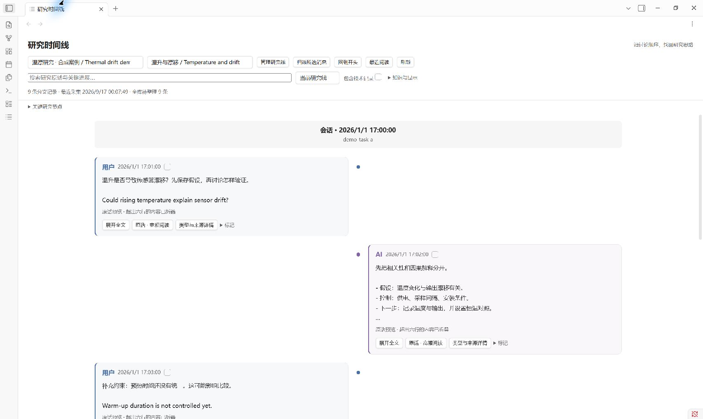
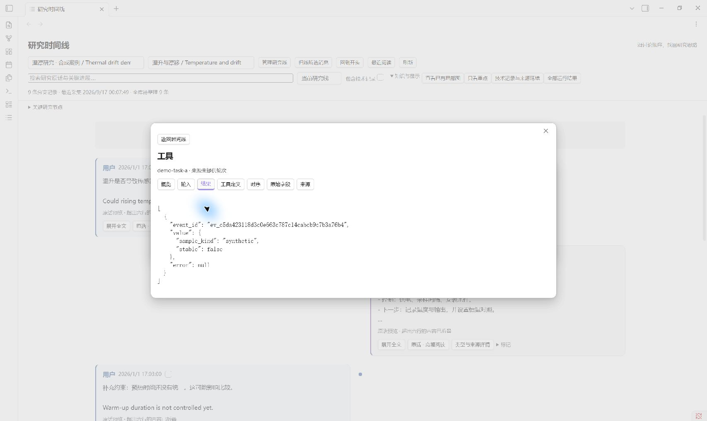
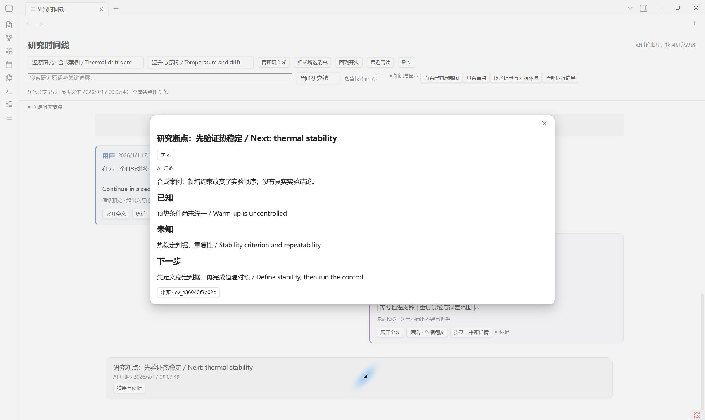

<div align="center">

# Research Memory

**Keep the question. Recover why the next step changed.**

A local research memory skill for Codex, with an optional Obsidian timeline.

[简体中文](README.zh-CN.md) · **English** · [Install](#quick-start) · [Examples](#one-question-two-tasks) · [Validation](VALIDATION.md)


</div>

Research rarely fits into one chat. A condition changes in another task; an experiment weakens an explanation; the next day, you need to recover **what changed, why, and where the evidence came from**.

Research Memory preserves public source messages and organizes them around research questions. Read the discussion in order, inspect important results, and open technical details when needed.



*Actual Obsidian rendering of a synthetic, bilingual thermal-drift case—not scientific evidence. Reader controls currently use Chinese; documentation and research content support English.*

## What you can do

| Need | Research Memory |
|---|---|
| Continue one question across tasks | Bind source tasks to a stable research workstream and read a bounded update brief. |
| Discuss several questions in one task | Assign continuous, complete message ranges; reference another line without duplicating the original. |
| Recover the discussion | Blue user / purple AI timeline; wide-screen lanes, narrow single column and full-text reading. |
| Find a meaningful result | Decisions, revisions, blockers and research checkpoints, with source links. |
| Check what actually happened | Typed user, assistant, context, tool and lifecycle details; separate tool inputs and results. |
| Correct organization | Version-checked changes and undo, with history retained. |
| Keep ownership of your data | Separate code, private data and registered workspaces. Obsidian is optional. |

## One question, two tasks

1. **Task A:** “Could temperature explain sensor drift?” Save the hypothesis and control conditions.
2. **Task A:** “Warm-up time was not controlled.” Preserve the new constraint and revise the plan.
3. **Task B:** Continue the same workstream. Recover the revision and identify missing repeated trials.
4. **Checkpoint:** Record what is known, what is unknown and the next experiment. Inspect technical records when needed.



*Inputs, results, source records and recorded timing are inspected separately. Demo tool values are labeled synthetic; missing metadata stays unknown.*



After initialization, reproduce the example with the instance's Python:

```powershell
& 'C:/ResearchMemory/MyArchive/runtime/venv/Scripts/python.exe' `
  ./scripts/showcase.py --root 'C:/ResearchMemory/PublicDemo' --with-obsidian
```

Use a new directory. This creates only synthetic messages; it does not read private transcripts or run a scientific experiment. Open its `vault` folder in Obsidian, enable the component yourself when prompted, then choose **打开研究时间线** (“Open research timeline”). The smaller `scripts/demo.py` example works without Obsidian.

### Video walkthrough

A maintainer-recorded walkthrough will be added here. The [recording guide](docs/DEMO.md) provides a scene sequence and instructions for adding the video to both homepages.

## Quick start

**Requirements:** Windows, Codex, Python 3.12+ available as `python`, and network access for initialization. Obsidian is optional. Node.js is only needed for development tests.

**1. Get the complete skill.** In Codex:

```text
Use skill-installer to install the repository root from
https://github.com/let778750-cpu/money-king
as a skill named research-memory.
```

Alternatively, download the [release ZIP](https://github.com/let778750-cpu/money-king/releases) into your Codex skill directory. Keep the complete `research-memory` folder; do not copy only `SKILL.md`. Open a new task afterward.

**2. Initialize private storage.** Run from the skill folder; replace these example paths:

```powershell
./scripts/install.ps1 -Workspace 'C:/Research/MyProject' `
  -DataDir 'C:/ResearchMemory/MyArchive'
./scripts/memory.ps1 --root 'C:/ResearchMemory/MyArchive' doctor
```

Initialization downloads pinned CPython 3.12.11 and locked dependencies into the private instance. Only the supplied workspace is registered. Add `-WithObsidian` for the reader; obtain Obsidian separately and open the reported vault. The timeline works without Juggl; the optional local graph uses Juggl 1.5.0.

**3. Start a research task.**

```text
Use $research-memory to continue the temperature-and-drift question.
Read relevant changes from the other task before proposing the next experiment.
```

The skill enters the research task, checks accessible transcripts and resumes its workstream. Installing a skill alone does not prove that hooks run on every turn. `doctor` separates configuration from observed coverage.

[Install / upgrade / uninstall](references/installation.md) · [API](references/research-api.md) · [Recording and cost](docs/RECORDING.md)

## Recording and token cost

| Layer | Execution |
|---|---|
| Archive public messages, tool records, hashes and indexes | Deterministic scripts; no additional model request. |
| Interpret significance, contradictions and next steps | The current session model, in bounded batches. |
| Continue research | Check the revision, then read relevant new information; the brief uses context. |

There is no background “cheap model recorder.” A skill is a workflow, not a resident watcher. Public explanations are preserved; hidden reasoning is not collected. Compaction records mark boundaries without copying private internal summaries.

The inspector borrows design principles from [DeepSeek Harness Trajectory](https://github.com/deepseek-ai/deepseek-harness/tree/master/packages/client/ui-trajectory). Research Memory adds persistent workstreams, evidence links and reversible organization across tasks. It does not claim Harness host support or invent request fields that Codex does not expose.

## Validation and limits

This is a **preview**. [VALIDATION.md](VALIDATION.md) separates automated engineering checks, actual UI observations and human research outcomes. Tests do not establish scientific correctness or measured retrieval benefits.

Live two-task hook coverage and the eleven-task human retrieval study remain separate acceptance items. The target of 20% lower median retrieval time with no loss of source accuracy is not an achieved result. Do not automatically replace an established production reader with this preview.

## Development

In an isolated Python 3.12 environment:

```powershell
python -m pip install uv==0.8.22
uv pip sync --python python integrations/release-requirements.lock.txt
uv pip install --python python --no-deps --no-build-isolation .
python -m pytest tests -q
node --test tools/obsidian/graph/*.test.cjs
python scripts/check_release.py
python scripts/build_obsidian.py --output build/obsidian
```

Windows CI, synthetic examples, component source code and per-file checksums are included. [Contributing](CONTRIBUTING.md) · [Issues](https://github.com/let778750-cpu/money-king/issues)

## License and acknowledgments

Original code: [AGPL-3.0](LICENSE). The existing Obsidian adapter retains GPL-3.0; third-party components retain their notices. See [THIRD_PARTY.md](THIRD_PARTY.md). Obsidian itself is not distributed.

Built with Python, Basic Memory, FastMCP and the Obsidian ecosystem. Harness inspired typed event projections; no Harness implementation code was copied.
